# 5. Interfejs UI/UX

## 5.1 Opis interfejsu

USBot ma dwa interfejsy na tym samym `ChatService`:

- **Strona WWW** (`web/`, Vite + React + TypeScript) — czat dla studentów. Korzysta z API
  HTTP ([API](api.md), 3.1): wysyła pytanie z historią rozmowy i pokazuje strumień zdarzeń
  SSE — odpowiedź pojawia się na bieżąco, numery źródeł [1] w tekście prowadzą do listy
  źródeł pod odpowiedzią, pytanie o dziekanat bez wydziału kończy się przyciskami wydziałów.
- **Terminal** (`cli.py`) — dla osób technicznych (administratorzy, testy); wypisuje te
  same zdarzenia jako tekst (5.6).

Strona nie używa bibliotek komponentów UI ani frameworków CSS — tylko React i jeden plik
`web/src/styles.css`. Odpowiedź modelu (Markdown: nagłówki, listy, pogrubienia, linki,
numery źródeł) renderuje mały parser w `web/src/markdown.tsx`, który buduje elementy Reacta
bez `innerHTML`, więc tekst z modelu nie może wstrzyknąć HTML-a, a linki są tylko `http(s)`.

**Styl.** Spokojny, „redakcyjny” wygląd serwisu publicznego, a nie aplikacji czatowej:
treść wyrównana do lewej w kolumnie ok. 70 znaków, hierarchię robią rozmiar i grubość
fontu, a nie kolory i ozdobniki; jeden akcent (bordo) dla linków, przycisku głównego i
numerów źródeł, reszta neutralna; odstępy i wypełnione szare przyciski zamiast ramek i
kart; zaokrąglenie 8 px dla kontrolek i 14 px dla elementów leżących nad rozmową (pole
pytania, panel ustawień) — tylko one mają cień. Fonty systemowe (Segoe UI, San Francisco, Roboto) —
zero bajtów do pobrania, bez zewnętrznych CDN. Bez logo i znaków UŚ: to projekt
studencki, nie oficjalny serwis uczelni (mówi o tym nagłówek i ekran powitalny).

**Tokeny.** Kolory, odstępy, promień, rozmiary fontu i szerokości są zmiennymi CSS na
początku `styles.css`. Każdy kolor to `light-dark(jasny, ciemny)`, więc motyw jasny i
ciemny to jedna deklaracja; wybór motywu ustawia tylko `color-scheme` (`light-dark()` —
przeglądarki od 2024 r.).

| Token | Jasny | Ciemny | Do czego |
|---|---|---|---|
| `--bg` | `#ffffff` | `#17191c` | tło strony |
| `--bg-subtle` / `--bg-hover` | `#f3f2f1` / `#e9e8e6` | `#22252a` / `#2c3036` | przyciski drugorzędne, przykładowe pytania, bloki stanu / tło pod kursorem |
| `--accent-subtle` | `#f6e9eb` | `#3a2428` | numer źródła, wskazane źródło, wciśnięte „Tak”/„Nie” |
| `--text` | `#1d1f23` | `#e8e9eb` | tekst |
| `--text-muted` | `#545961` | `#a9aeb6` | metadane, podpowiedzi |
| `--line` / `--border` | `#d6d9de` / `#767b84` | `#3a3e45` / `#868b94` | linie dekoracyjne / obramowania pól i przycisków |
| `--accent` | `#8b1e2e` | `#eb9aa5` | linki, przycisk główny, numery [n] |
| `--warn`, `--warn-bg` | `#a35a00`, `#fdf3e1` | `#e0a650`, `#2e2513` | ostrzeżenie o nieaktualnym komunikacie |
| `--danger` | `#b3261e` | `#f2a59c` | błąd, za długie pytanie |
| `--focus-outer` / `--focus-inner` | `#1d1f23` / `#ffbf47` | `#ffbf47` / `#17191c` | obwódka fokusu |

Uruchomienie: [Instrukcja uruchomienia](uruchomienie.md) (krok 7c) albo README.

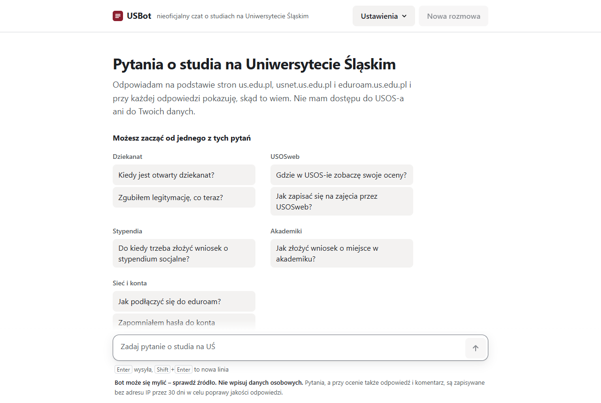

Układ strony od góry:

| Element | Opis |
|---|---|
| Nagłówek | **USBot** i dopisek „nieoficjalny czat o studiach na Uniwersytecie Śląskim”; przyciski **Ustawienia** (rozwija panel: motyw — jak w systemie / jasny / ciemny — i rozmiar tekstu A− / A+, 87,5–150%) i **Nowa rozmowa** |
| Baner stanu | tylko gdy `GET /api/health` przy otwarciu strony zgłasza problem — „Czat może teraz nie działać. Niedostępne: model językowy…” z przyciskiem „Sprawdź ponownie” |
| Rozmowa | ekran powitalny albo lista tur: pytanie jako nagłówek tury (większy, pogrubiony), pod nim odpowiedź, ostrzeżenie, źródła, „Kopiuj odpowiedź” i ocena |
| Pole pytania | karta z cieniem przy dolnej krawędzi (tekst rozmowy wygasa nad nią); rośnie razem z tekstem (do 12rem); przycisk ze strzałką (nazwa „Wyślij”) — w trakcie odpowiedzi zamieniony na **Zatrzymaj**; licznik znaków dopiero od 1800 z 2000 |
| Stopka | stały komunikat **„Bot może się mylić – sprawdź źródło. Nie wpisuj danych osobowych.”** i informacja o zapisywaniu pytań bez adresu IP przez 30 dni (RODO — Architektura, 2.4) |

**Ekran powitalny** (`web/src/components/Welcome.tsx`): tytuł „Pytania o studia na
Uniwersytecie Śląskim”, dwa zdania o tym, skąd bot bierze odpowiedzi i czego nie widzi
(USOS, dane osobowe), oraz 8 przykładowych pytań w grupach: Dziekanat, USOSweb, Stypendia,
Akademiki, Sieć i konta. Pytania są z zestawów testowych (`evaluation/`), więc baza ma na
nie odpowiedź; „Kiedy jest otwarty dziekanat?” pokazuje dopytanie o wydział. Pytania to
lista wierszy z szarym tłem pod nagłówkami grup (pod kursorem ciemniejsze, tekst w akcencie).

## 5.2 Opis nawigacji

### Strona WWW

| Akcja użytkownika | Zachowanie |
|---|---|
| Wpisanie pytania + `Enter` (albo **Wyślij**) | Pytanie trafia do rozmowy, pole się czyści; odpowiedź generuje się strumieniowo. |
| `Shift`+`Enter` | Nowa linia w pytaniu. |
| `Esc` albo **Zatrzymaj** (w trakcie odpowiedzi) | Przerwanie `fetch` (`AbortController`) — serwer przestaje generować; to, co powstało, zostaje z dopiskiem „Odpowiedź przerwana”. |
| Kliknięcie przykładowego pytania | Wysyła je od razu. |
| Kliknięcie numeru źródła [n] w odpowiedzi albo w ostrzeżeniu | Przewija do źródła n na liście pod odpowiedzią (rozwija „Pozostałe znalezione strony”, jeśli tam jest), podświetla je na 2 s i przenosi na nie fokus. |
| **Kopiuj odpowiedź** | Kopiuje odpowiedź jako zwykły tekst (bez znaczników Markdownu) z ostrzeżeniem i listą cytowanych źródeł z adresami; obok „Skopiowano.” |
| Kliknięcie przycisku wydziału (po `clarify`) | Wysyła skrót wydziału, np. „WNP” — serwer rozwija go do pełnej nazwy i łączy z poprzednim pytaniem. |
| **Spróbuj ponownie** (po błędzie) | Wysyła to samo pytanie jeszcze raz, zastępując turę z błędem. Po `429`/`503` przycisk odlicza „Spróbuj ponownie za N s”. |
| **Ustawienia** | Rozwija panel motywu i rozmiaru tekstu; `Esc` albo kliknięcie obok zamyka go (`Esc` oddaje fokus przyciskowi). |
| **Nowa rozmowa** | Przerywa ewentualną odpowiedź, czyści rozmowę i przenosi fokus do pola pytania. |
| Odświeżenie strony | Rozmowa zostaje (sessionStorage); znika po zamknięciu karty. Odpowiedź przerwana odświeżeniem jest oznaczona jako przerwana. |
| Pierwszy `Tab` na stronie | Link „Przejdź do pola pytania” (skip link). |

Pytanie pustej treści nie jest wysyłane (przycisk wyłączony). Dłuższe niż 2000 znaków —
licznik robi się czerwony („Pytanie jest za długie: 2104 z 2000 znaków”), pole dostaje
`aria-invalid`, wysyłanie jest zablokowane.

### Terminal

| Akcja użytkownika | Zachowanie systemu |
|---|---|
| Wpisanie pytania + Enter | Bot buduje zapytanie z kontekstem, pobiera fragmenty z bazy, generuje odpowiedź (streaming). |
| Pusty Enter | System ignoruje wejście, wyświetla prompt ponownie. |
| `wyjdź` / `exit` / `quit` / `q` | Komunikat „Do widzenia!" i zamknięcie procesu. |
| `Ctrl+C` lub `Ctrl+D` (EOF) | Graceful exit z komunikatem „Do widzenia!". |
| Błąd bazy danych | Komunikat błędu z instrukcją uruchomienia Dockera, pętla kontynuowana. |
| Brak danych w bazie | Bot informuje o braku informacji, sugeruje us.edu.pl lub dziekanat. |
| Pytanie o dziekanat bez wydziału | Bot dopytuje o wydział i wymienia wszystkie (bez wywołania LLM-a); odpowiedź może być skrótem, np. „WNP”. |

## 5.3 Strona WWW — stany i zdarzenia API

Każda tura (pytanie + odpowiedź) ma jeden stan (`TurnStatus` w `web/src/types.ts`).
Zdarzenia z `POST /api/chat` ([API](api.md), 3.1) przełączają go tak:

| Zdarzenie / sytuacja | Stan tury | Widok |
|---|---|---|
| (wysłanie pytania) | `searching` | pytanie jako nagłówek tury; pod nim „Szukam na stronach uczelni…” z cienkim paskiem postępu; **Wyślij** → **Zatrzymaj** |
| `sources` | `writing` | „Piszę odpowiedź na podstawie 5 stron…” do pierwszego tokenu; pod spodem „Źródła” ze zwiniętą listą „Znalezione strony (5)” |
| `token` | `writing` | tekst dopisywany na bieżąco (Markdown), pod nim „Piszę dalej…”; zacytowane strony przechodzą na wierzch listy źródeł, gdy tylko pojawi się ich numer |
| `done` | `done` | pełna odpowiedź (`answer`) zastępuje sklejone tokeny; pod nią ostrzeżenie (jeśli jest), źródła, **Kopiuj odpowiedź** i „Czy ta odpowiedź pomogła? **Tak** / **Nie**” |
| `refused` (+ `done`) | `refused` | blok z szarą linią: „Nie znalazłem tego na stronach UŚ”, komunikat serwera, podpowiedź, by zapytać inaczej, i przycisk-link **Przejdź do us.edu.pl**; bez źródeł i ocen |
| `clarify` (+ `done`) | `clarify` | pierwsze zdanie komunikatu i przyciski wydziałów (nazwa + skrót) z `options`; gdy `options` przyjdzie puste — lista z `GET /api/faculties`. Przyciski działają tylko w ostatniej turze |
| `error` | `error` | blok z czerwoną linią: „Nie udało się uzyskać odpowiedzi” + `message` z serwera (np. „Model językowy jest niedostępny.”) i **Spróbuj ponownie** |
| strumień zamknięty bez `done`/`error` | `error` | „Połączenie zostało przerwane przed końcem odpowiedzi.” |
| **Zatrzymaj** / `Esc` | `stopped` | wygenerowana część + „Odpowiedź przerwana.” (albo „Zatrzymano, zanim powstała odpowiedź.”) |
| HTTP `429` / `503` | `error` | „Chwila przerwy”: „Za dużo pytań w krótkim czasie. Spróbuj ponownie za N s.” (`503`: „Serwer jest teraz zajęty…”) — N z `Retry-After`; przycisk „Spróbuj ponownie za N s” i licznik pod polem odliczają, **Wyślij** i **Spróbuj ponownie** są zablokowane do końca odliczania (pole można dalej edytować) |
| HTTP `422` | `error` | „Pytanie albo historia rozmowy są za długie. Skróć pytanie lub zacznij nową rozmowę.” |
| brak połączenia (`fetch` odrzucony) | `error` | „Brak połączenia z serwerem czatu. Sprawdź połączenie z internetem i spróbuj ponownie.” |

**Koniec odpowiedzi.** Serwer dokleja do odpowiedzi (`usbot/core/citations.py`)
ostrzeżenie „**Uwaga:** źródło [3] (komunikat z 24 marca 2025 r.) ma ponad rok…” i listę
„Źródła:\n[3] adres”. Strona (`web/src/answer.ts`, `parseAnswer`) przy wyświetlaniu wycina
listę z tekstu — źródła są pod odpowiedzią, więc się nie dublują — a ostrzeżenie pokazuje
jako wyróżniony blok „Informacja może być nieaktualna” (żółte tło, gruba linia). Tekst w
turze, w historii dla API i w ocenie zostaje bez zmian. Kontrakt API się nie zmienił.

**Źródła** pochodzą wyłącznie ze zdarzenia `sources` (wyniki wyszukiwania), nie z tekstu
odpowiedzi. Numer [n] w odpowiedzi to `sources[n - 1]` — serwer numeruje strony w
kolejności wyników, każdą raz (`source_numbers()` i `sources()` w `usbot/core`), więc
strona nie musi parsować adresów ze stopki. Na liście:

- na wierzchu tylko strony zacytowane w odpowiedzi, z tym samym numerem co w tekście;
  pozostałe znalezione strony są zwinięte („Pozostałe znalezione strony (3)”); gdy model
  nic nie zacytował, po zakończeniu widać wszystkie jako „Znalezione strony”;
- tytuł bez dopisków serwisu („| Student”, „« Uczelniana Sieć Komputerowa USNET”) i bez
  wersalików („KONFIGURACJA” → „Konfiguracja”), link w nowej karcie; pod nim domena;
- wpis FAQ: plakietka **FAQ** i „wpis sprawdzony ręcznie, strona us.edu.pl” (link do
  strony źródłowej, jeśli wpis ją ma);
- komunikat i wydarzenie: „komunikat z 2 listopada 2026”; ponad rok temu — wyróżnione
  „komunikat z 24 marca 2025, ponad rok temu”. Przy zwykłych stronach daty nie ma: to data
  utworzenia strony, nie aktualności (Testy, 6.14).

**Historia rozmowy** jest w pamięci karty i w `sessionStorage` (klucz `usbot.conversation`)
— serwer jest bezstanowy. Z każdym pytaniem strona wysyła ostatnie 5 tur
(`API_HISTORY_TURNS`; starszych serwer i tak nie użyje), w limitach API (40 wiadomości,
40 000 znaków — przy przekroczeniu odpada najstarsza tura). Zgodnie z kontraktem do
historii trafia pytanie i `done.answer`; przy `refused`/`clarify` — ich komunikat; po
`error` — samo pytanie; po przerwaniu — pytanie i wygenerowana część (użytkownik ją widzi,
więc model też powinien). Logika: `web/src/history.ts`.

**Oceny „Tak” / „Nie”** są pod każdą odpowiedzią `done`, obok pytania „Czy ta odpowiedź
pomogła?”. „Tak” wysyła ocenę od razu. „Nie” otwiera formularz z opcjonalnym komentarzem i
przypomnieniem, by nie wpisywać danych osobowych: fokus trafia do pola, **Esc** albo
**Anuluj** zamyka formularz i wraca na przycisk „Nie”, a ocena idzie do serwera dopiero po
**Wyślij ocenę**. Jedna odpowiedź to jedna ocena. Żądanie opisuje [API](api.md) (3.1,
`POST /api/feedback`). Przy `VITE_FEEDBACK_ENABLED=false` przyciski są widoczne, ale
wyłączone, a odpowiedź `404`/`405` wyłącza oceny do końca wizyty.

**Kopiuj odpowiedź** używa Clipboard API; gdy przeglądarka go nie udostępnia (HTTP poza
localhost, brak zgody), kopiuje przez ukryte pole tekstowe. Gdy i to zawiedzie, obok
przycisku pojawia się „Nie udało się skopiować. Zaznacz tekst i skopiuj ręcznie.”

### Zrzuty ekranu

Zrzuty z prawdziwego API (Ollama `qwen3:8b`, baza z 2026-11), robione skryptem
`npm run e2e` (`web/scripts/e2e.mjs`, 5.5) 2026-11-24. Zrzuty cytowań, błędu połączenia i
limitu mają podstawioną odpowiedź serwera (w tym samym formacie), żeby były powtarzalne.

**Strumieniowanie** — tekst dopisywany na bieżąco, „Piszę dalej…”, przycisk **Zatrzymaj**:

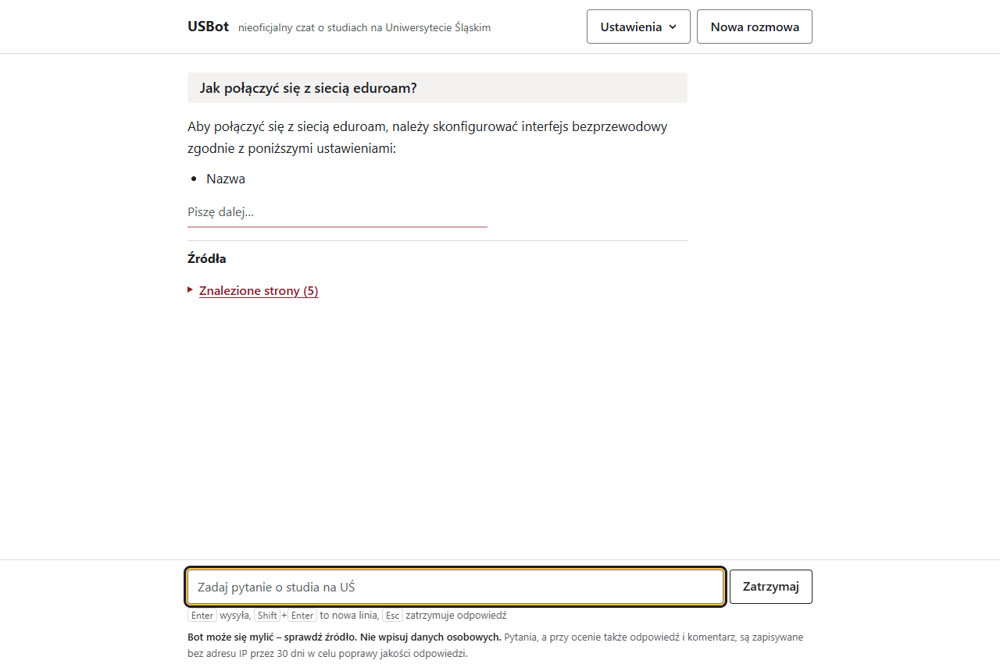

**Odpowiedź ze źródłami, kopiowaniem i oceną:**

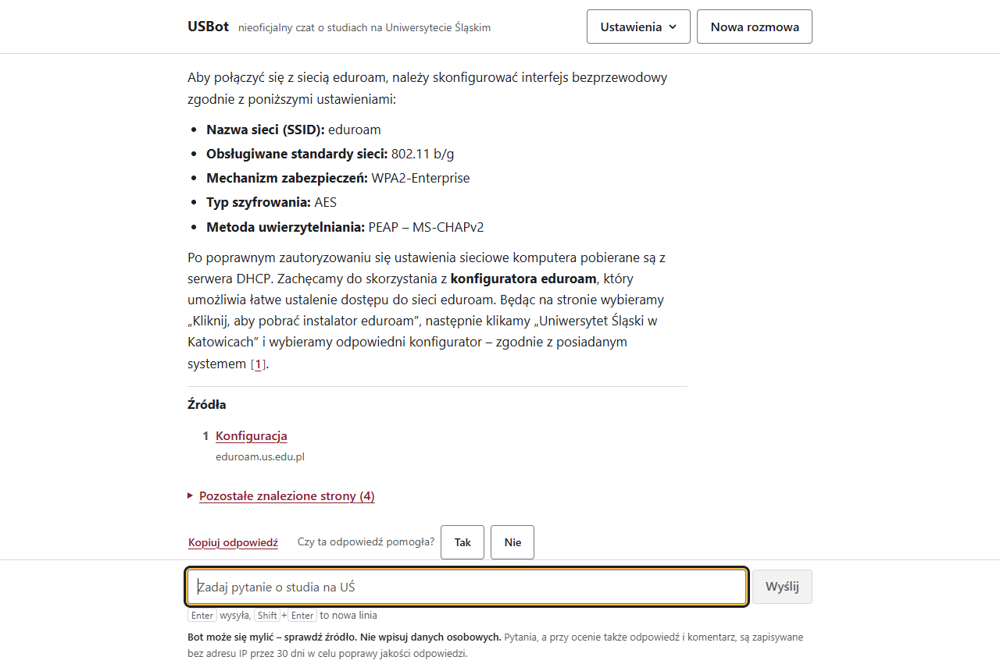

**Klikalne numery źródeł i ostrzeżenie** — po kliknięciu [3] w ostrzeżeniu źródło 3 jest
podświetlone i ma fokus; wpis FAQ z plakietką, stary komunikat wyróżniony:

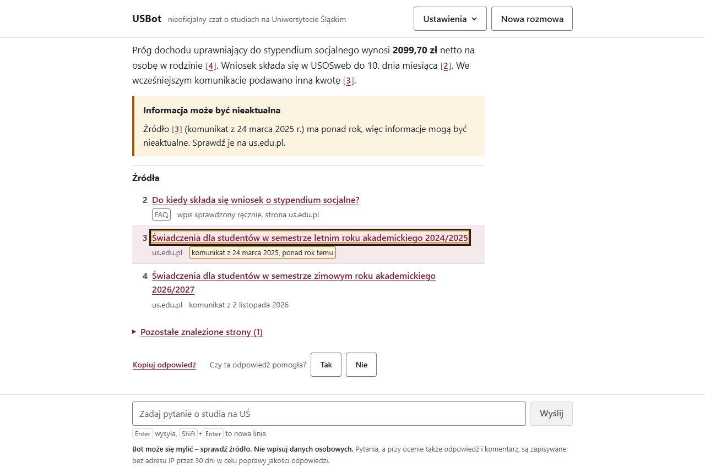

**Dopytanie o wydział** (`clarify`) i odpowiedź po kliknięciu „WNP”:

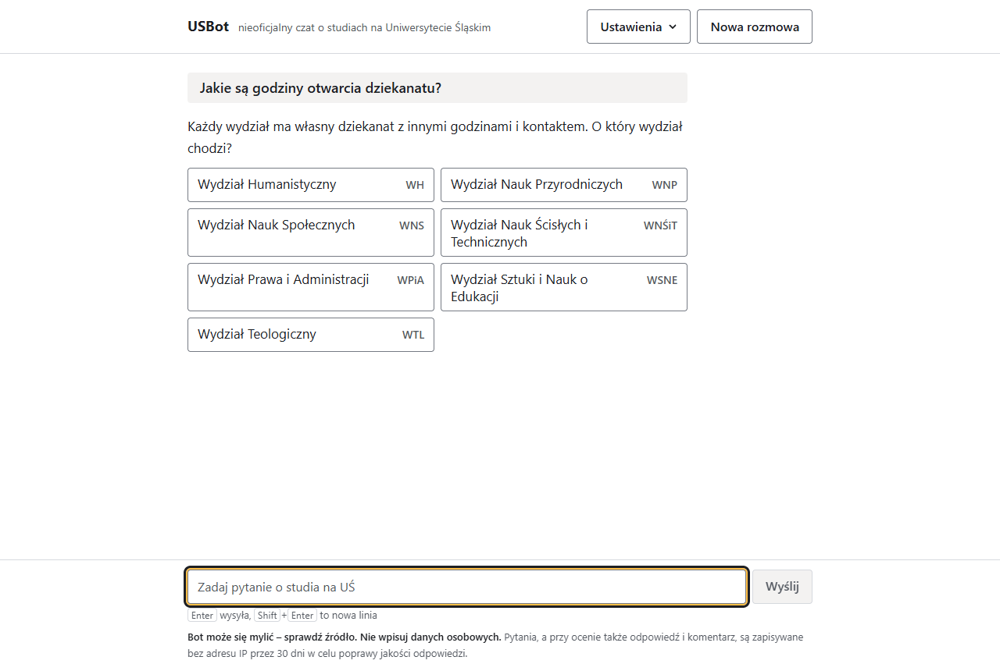

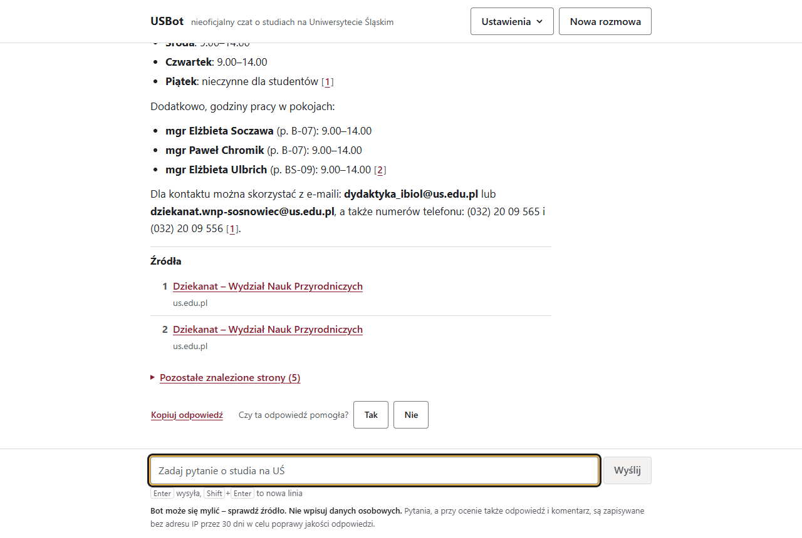

**Brak informacji** (`refused`):

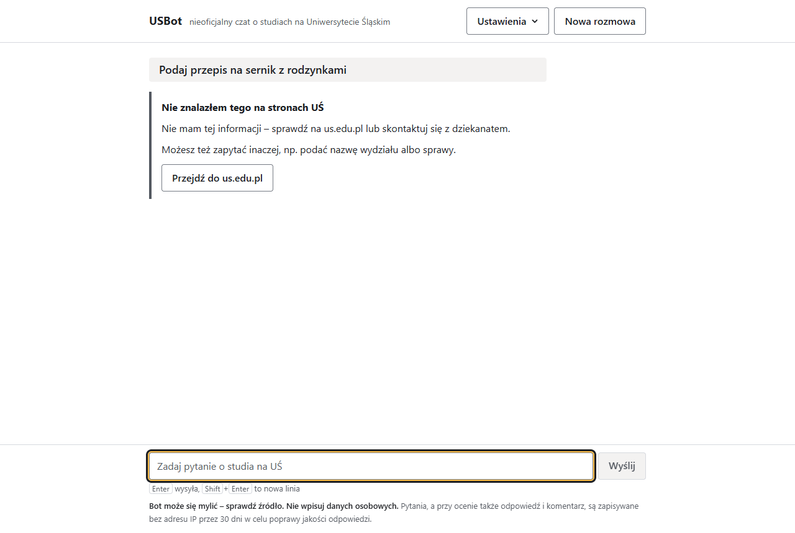

**Przerwana odpowiedź** (`Esc` w trakcie generowania):

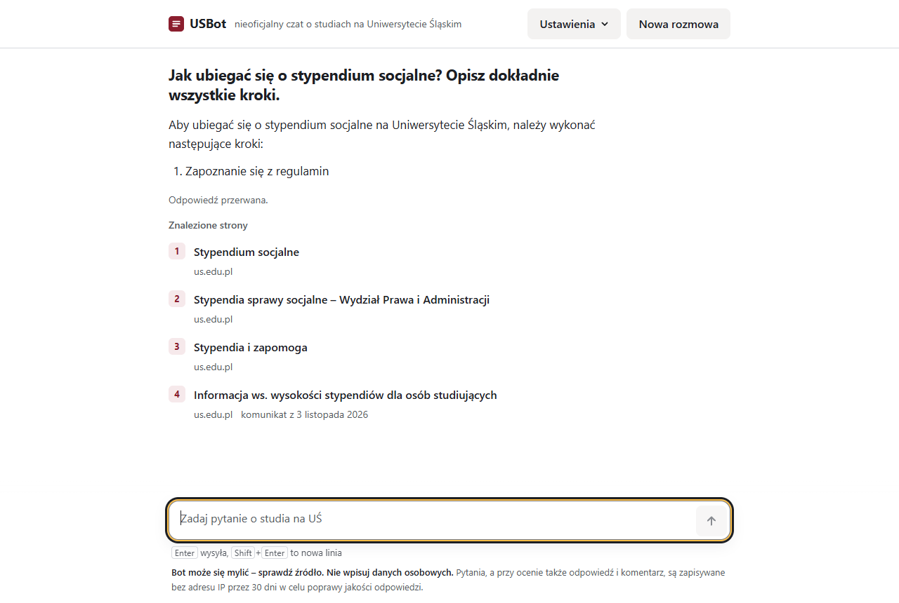

**Limit zapytań** (HTTP `429` z `Retry-After: 42`) i **brak połączenia**:

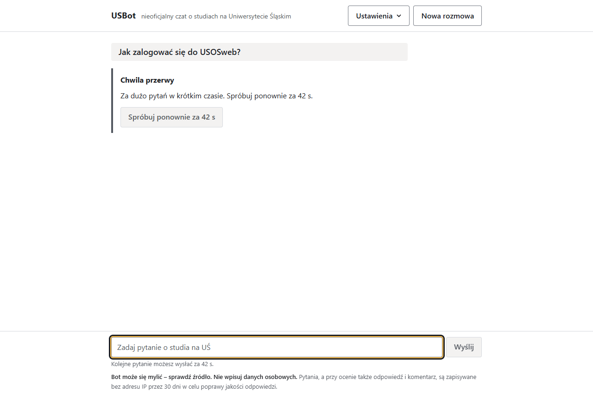

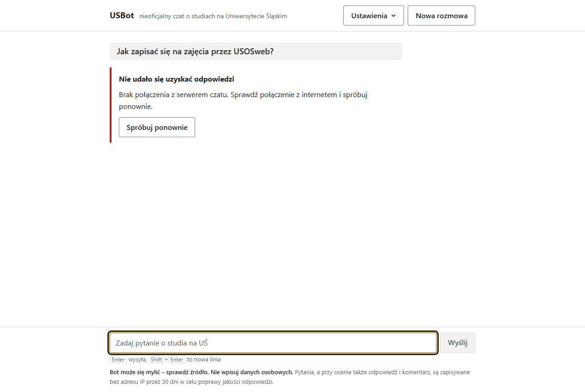

**Ustawienia**, **tryb ciemny**, **telefon** (390 px) i **tekst 125%**:

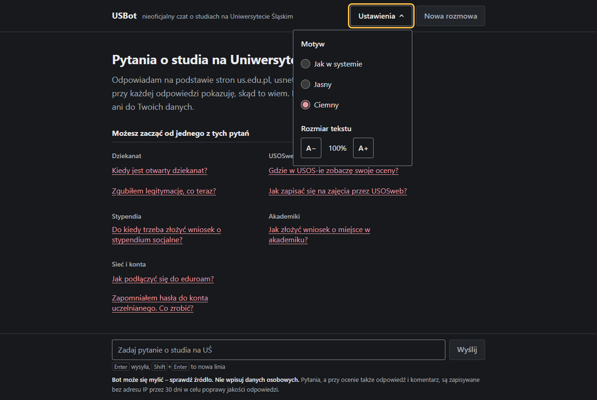

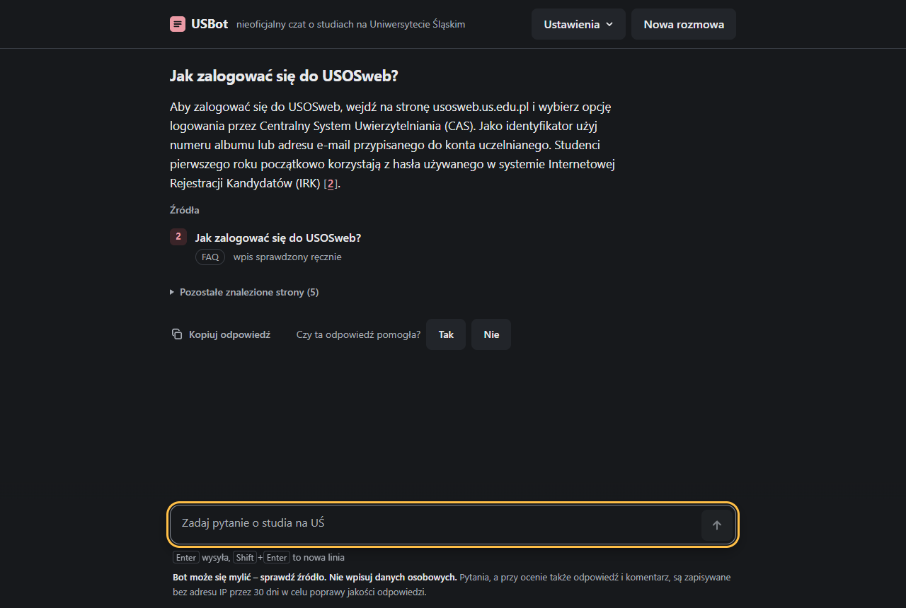

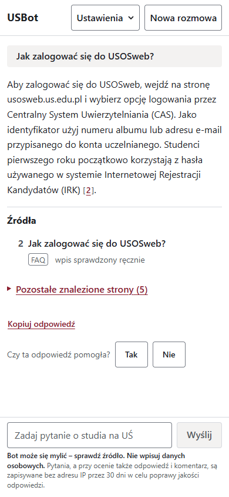

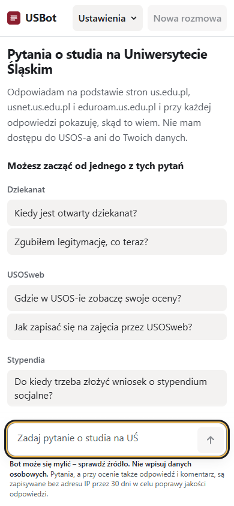

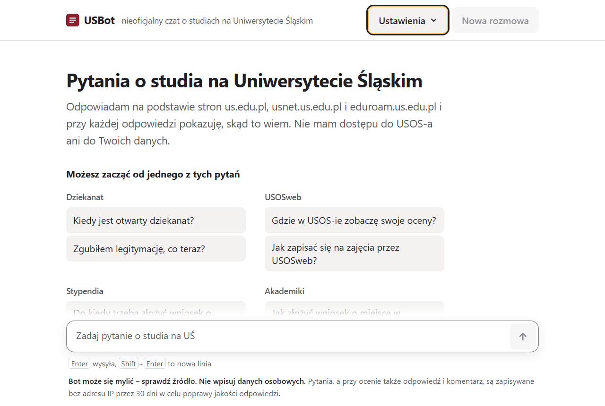

## 5.4 Dostępność (WCAG 2.1 AA)

| Wymaganie | Rozwiązanie |
|---|---|
| Kontrast (1.4.3, 1.4.11) | Kolory jako tokeny w `web/src/styles.css` (5.1), sprawdzone dla obu motywów: tekst 16,5:1 / 14,5:1, tekst pomocniczy 7,1:1 / 7,9:1 (na szarym tle pytania 6,3:1 / 6,9:1), akcent (linki, [n]) 9,0:1 / 8,1:1, ostrzeżenie 5,2:1 / 8,2:1, obramowania pól i przycisków 4,3:1 / 5,2:1. W trybie wysokiego kontrastu Windows (`forced-colors`) pytanie, bloki stanu i panel ustawień dostają systemowe obramowanie, a wskazane źródło — obwódkę `Highlight` |
| Obsługa klawiaturą (2.1.1, 2.4.3, 2.4.7) | Wszystko to natywne `button`/`a`/`input`/`textarea`/`details`; kolejność Tab: skip link → **Ustawienia** → **Nowa rozmowa** → rozmowa (przewijalna klawiszami strzałek) → przyciski w turach → pole pytania. Fokus: ciemna obwódka 3 px na żółtej (w ciemnym motywie żółta) — widoczna na każdym tle i odróżnia się od bordowych linków. Panel ustawień to wzorzec disclosure (`aria-expanded`, `aria-controls`), `Esc` zamyka go i oddaje fokus. Klik numeru [n] przenosi fokus na źródło. Po kliknięciu wydziału i „Spróbuj ponownie” fokus wraca do pola pytania |
| Strumieniowana odpowiedź (4.1.3) | Ukryty region `aria-live="polite"`, `aria-relevant="additions"`. Czytanie każdego tokenu byłoby nieużywalne, więc tokeny są zbierane i do regionu trafia każde **zakończone zdanie** jako nowy element (czytnik je kolejkuje), bez znaczników Markdownu i bez listy adresów „Źródła:”. Do tego komunikaty stanu: „Szukam na stronach uczelni…”, „Znalazłem strony: 5. Piszę odpowiedź…”, komunikat `refused`/`clarify`, „Zatrzymano generowanie odpowiedzi.”, błędy. Odpowiedź ma `aria-busy="true"` do końca strumienia. „Skopiowano.” i podziękowanie za ocenę są w `role="status"`. Logika: `web/src/useAnnouncer.ts` |
| Nazwy elementów (1.3.1, 2.5.3, 4.1.2) | Pytanie w turze to nagłówek `h3` (nawigacja nagłówkami po rozmowie), źródła — `h4`; numer [n] to przycisk z nazwą „Źródło 3: <tytuł strony>”; „Tak”/„Nie” w grupie nazwanej widocznym pytaniem „Czy ta odpowiedź pomogła?”, z `aria-pressed`; motyw — `fieldset` z `legend`; linki do nowej karty z ukrytym dopiskiem „(otwiera się w nowej karcie)”; błędy z `role="alert"`, ostrzeżenie z `role="note"` |
| Skalowanie tekstu (1.4.4, 1.4.10) | Rozmiary w `rem`; działa zoom przeglądarki do 200% i **Rozmiar tekstu** w ustawieniach (87,5–150%, zapamiętany w `localStorage`). Bez poziomego przewijania od 360 px |
| Tryb ciemny | Domyślnie wg systemu (`prefers-color-scheme`), do wyboru w **Ustawieniach**; ustawiany przed pierwszym malowaniem (`public/theme-init.js`, bez mignięcia jasnego tła) |
| Język (3.1.1) | `<html lang="pl">`, cały interfejs po polsku |
| Etykiety (3.3.2) | Pole pytania z etykietą „Twoje pytanie” i opisem (skróty klawiszowe, licznik znaków) |
| Ruch (2.3.3) | Przy `prefers-reduced-motion` bez animacji paska postępu, bez płynnego przewijania i bez przejść (podświetlenie źródła, strzałki) |
| Cele dotyku (2.5.5, poziom AAA — dodatkowo) | Przyciski, przykładowe pytania, „Pozostałe znalezione strony” i link do us.edu.pl mają min. 44 px wysokości (e2e sprawdza to na 360, 390 i 430 px). Wyjątek: numery [n] w zdaniu — cele w tekście (2.5.8 je wyłącza) |
| Telefon | Pole pytania przyklejone do dołu (`100dvh`, `env(safe-area-inset-bottom)`, `interactive-widget=resizes-content` — klawiatura nie zasłania pola); nagłówek w jednym wierszu od 360 px; podpowiedzi klawiszowe schowane |

Narzędzia automatycznego audytu (axe) nie uruchamiano — wymagałoby nowej zależności;
kontrast policzony ze wzoru WCAG dla tokenów, resztę sprawdza e2e (5.5).

## 5.5 Testy interfejsu

- `npm test` (Vitest) — parser SSE (zdarzenia urwane w dowolnym miejscu, `: ping`, CRLF,
  uszkodzony JSON), budowanie historii z tur w każdym stanie i limity, renderer Markdownu
  (brak wstrzyknięcia HTML-a, linki tylko `http(s)`, brak zagnieżdżonych linków, urwane
  `**`, numery [1, 2] jako przyciski tylko dla istniejących źródeł), `answer.ts` (wycinanie
  stopki „Źródła:” także w trakcie strumienia, wydzielenie ostrzeżenia, numery cytowań,
  tytuły źródeł, tekst do schowka), lista źródeł (cytowane na wierzchu, reszta zwinięta,
  FAQ, daty tylko przy komunikatach) i ekran powitalny (8 pytań w 5 grupach, wyłączone w
  trakcie odpowiedzi).
- `npm run e2e` (`web/scripts/e2e.mjs`) — headless Chrome przez DevTools Protocol, bez
  dodatkowych zależności; wymaga działającego API i `npm run dev`. Scenariusze: kolejność
  Tab i skip link, `Shift+Enter`; powitanie (grupy, 8 pytań); ustawienia (Enter otwiera,
  motyw, `Esc` zamyka i oddaje fokus); strumieniowanie, źródła, brak listy „Źródła:” w
  tekście, oceny Tak/Nie, brak emoji, `aria-busy`, region `aria-live`, sessionStorage po
  odświeżeniu; cytowania (podstawiona odpowiedź: przyciski [n], blok ostrzeżenia, 3
  cytowane źródła + 1 zwinięte, FAQ, data komunikatu, klik [3] → fokus i podświetlenie,
  wygaszenie po 2 s, kopiowanie); błąd połączenia; `clarify` → klik „WNP” → odpowiedź;
  `refused` z linkiem; `Esc` w trakcie odpowiedzi; `429` z odliczaniem; tryb ciemny;
  telefon 360/390/430 px (bez poziomego przewijania, nagłówek w jednym wierszu, pole przy
  dolnej krawędzi, cele dotyku ≥ 44 px); tekst 125%; brak błędów w konsoli. Zapisuje zrzuty
  do `docs/img/ui/`. Wynik z 2026-11-24: wszystkie scenariusze OK.

**Rozmiar.** Zbudowany JS + CSS (gzip): przed zmianami z 5.7 — 76,8 KB + 3,0 KB, po —
79,3 KB + 3,9 KB (+3,3 KB), po drugiej iteracji — 79,6 KB + 4,3 KB (+4,1 KB). Bez nowych zależności.

## 5.6 Terminal (CLI) — stany

### Stan: uruchomienie

```text
Ładowanie modelu embeddingów (pierwsze uruchomienie może chwilę potrwać)...
============================================================
   Bot Uniwersytetu Śląskiego w Katowicach
   Wpisz 'wyjdź' lub Ctrl+C aby zakończyć
============================================================
```

### Stan: błąd bazy danych

```text
[Błąd bazy danych: connection refused]
[Upewnij się że Postgres działa i uruchom: docker compose up -d db]
```

### Stan: brak informacji

```text
Bot: Nie mam tej informacji - sprawdź na us.edu.pl lub skontaktuj się z dziekanatem.
```

### Stan: dopytanie o wydział

```text
Ty: Jakie są godziny otwarcia dziekanatu?

Bot: Każdy wydział ma własny dziekanat z innymi godzinami i kontaktem. O który wydział chodzi?
- Wydział Humanistyczny (WH)
- Wydział Nauk Przyrodniczych (WNP)
- Wydział Nauk Społecznych (WNS)
- Wydział Nauk Ścisłych i Technicznych (WNŚiT)
- Wydział Prawa i Administracji (WPiA)
- Wydział Sztuki i Nauk o Edukacji (WSNE)
- Wydział Teologiczny (WTL)

Ty: WNP
```

Po odpowiedzi bot szuka z pełną nazwą wydziału i odpowiada już przez LLM-a.

!!! note "Kodowanie znaków"
    Na Windows aplikacja jawnie ustawia `sys.stdout.reconfigure(encoding="utf-8")`,
    bo domyślne `cp1252` nie obsługuje polskich znaków. Dzięki temu interfejs działa
    poprawnie na każdym systemie.

## 5.7 Co się zmieniło w interfejsie WWW i dlaczego (2026-11-24)

| Było | Jest | Dlaczego |
|---|---|---|
| W nagłówku 5 kontrolek (lista motywu, A−, 100%, A+, Nowa rozmowa); na telefonie 2 wiersze | **Ustawienia** (panel z motywem i rozmiarem tekstu) i **Nowa rozmowa** | ustawienia zmienia się raz, a zajmowały miejsce stale; na telefonie nagłówek mieści się w jednym wierszu od 360 px |
| Niebieski kwadrat „US” jak logo | sama nazwa i dopisek „nieoficjalny czat…” | projekt studencki nie powinien wyglądać jak znak uczelni |
| Wyśrodkowane „W czym mogę pomóc?” i 4 kafelki z cieniem | tytuł o temacie, 2 zdania o źródłach i ograniczeniach, 8 pytań w 5 grupach jako lista | wiadomo od razu, o co można pytać i skąd są odpowiedzi; pytania brzmią jak studenci |
| Odpowiedź w karcie z cieniem, pytanie w niebieskim dymku | pytanie jako nagłówek tury, odpowiedź jako zwykły tekst w kolumnie ok. 70 znaków | linie przy 1280 px miały 110–120 znaków; czyta się jak stronę, nie komunikator |
| Lista „Źródła: [1] https://…” w tekście **i** karty „ŹRÓDŁA (7)” | lista wycięta z tekstu, pod odpowiedzią tylko cytowane źródła z tym samym numerem, reszta zwinięta | źródła się dublowały, a 7 kart przy 3 cytowanych zasłaniało, które strony naprawdę są podstawą odpowiedzi |
| Numer [1] w tekście był zwykłym tekstem | [1] to przycisk: przewija do źródła, podświetla je i przenosi fokus | najkrótsza droga od zdania do jego źródła |
| Siatka kart z długimi ściętymi ścieżkami i datą „z 4 grudnia 2019” przy każdej stronie | tytuł bez dopisków serwisu, domena, plakietka FAQ, data tylko przy komunikatach i wydarzeniach | data utworzenia zwykłej strony sugerowała, że informacja jest stara |
| „**Uwaga:** … nieaktualne” jako zwykły akapit i mała plakietka na karcie | wyróżniony blok „Informacja może być nieaktualna” z klikalnym numerem źródła | najważniejsze ostrzeżenie było najsłabiej widoczne |
| 👍/👎 w przyciskach 36 px | „Czy ta odpowiedź pomogła? **Tak** / **Nie**”, 44 px; obok **Kopiuj odpowiedź** | emoji wyglądają różnie w systemach i są szablonowe; brakowało kopiowania |
| Migający kursor-blok i kropki „pisania” | „Szukam na stronach uczelni…”, „Piszę odpowiedź na podstawie 5 stron…”, „Piszę dalej…” z cienkim paskiem postępu | mówi, co się dzieje, zamiast imitować pisanie |
| Limit: wyszarzone „Spróbuj ponownie” bez wyjaśnienia | „Chwila przerwy” i przycisk „Spróbuj ponownie za 42 s” | wiadomo, dlaczego przycisk nie działa i jak długo |
| `refused`: sam komunikat z żółtym paskiem | „Nie znalazłem tego na stronach UŚ”, podpowiedź i link do us.edu.pl | nagłówek mówi, co się stało |
| Pole pytania + podpowiedzi + licznik `0/2000` zawsze (ok. 175 px, na telefonie 235 px) | pole rośnie z tekstem, licznik od 1800 znaków, na telefonie bez podpowiedzi klawiszowych | więcej miejsca na rozmowę, szczególnie na telefonie |
| Niebieski akcent i pomarańczowy fokus, cienie, promień 0,75rem | tokeny w jednym miejscu (`light-dark()`), bordo jako jedyny akcent, linie zamiast cieni, promień 4 px, fokus ciemny na żółtym | spokojny, „redakcyjny” wygląd; jeden kolor znaczy „można kliknąć” |

**Przegląd „czy nie wygląda na wygenerowane”.** Sprawdzone elementy i decyzje:

- *Zmienione:* logo „US”; nagłówek „W czym mogę pomóc?”; kafelki z cieniem (powitanie,
  źródła); emoji 👍/👎 i „■” w „Zatrzymaj”; etykieta „ŹRÓDŁA” wersalikami; migający
  kursor-blok; niebieski dymek pytania; puste kółka w listach odpowiedzi.
- *Zostaje, z uzasadnieniem:* pytanie jako większy nagłówek — odróżnia je od odpowiedzi
  bez dymków; plakietki tylko przy FAQ i starym komunikacie —
  niosą informację, nie są przy każdym elemencie; pasek postępu przy „Szukam…” — jedyna
  animacja, wyłączana przy `prefers-reduced-motion`; obwódka fokusu żółto-czarna —
  sprawdzony w serwisach publicznych wzorzec dostępności, nie ozdobnik; pierwsza osoba
  („Nie znalazłem”, „Odpowiadam na podstawie…”) — bez „Jako asystent AI”.

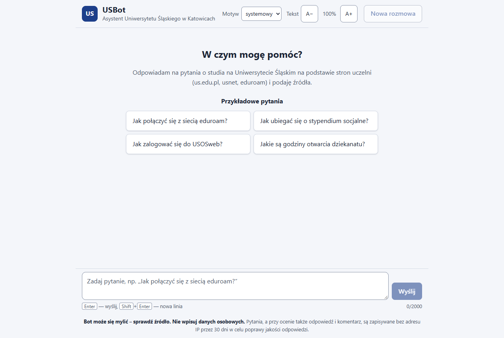

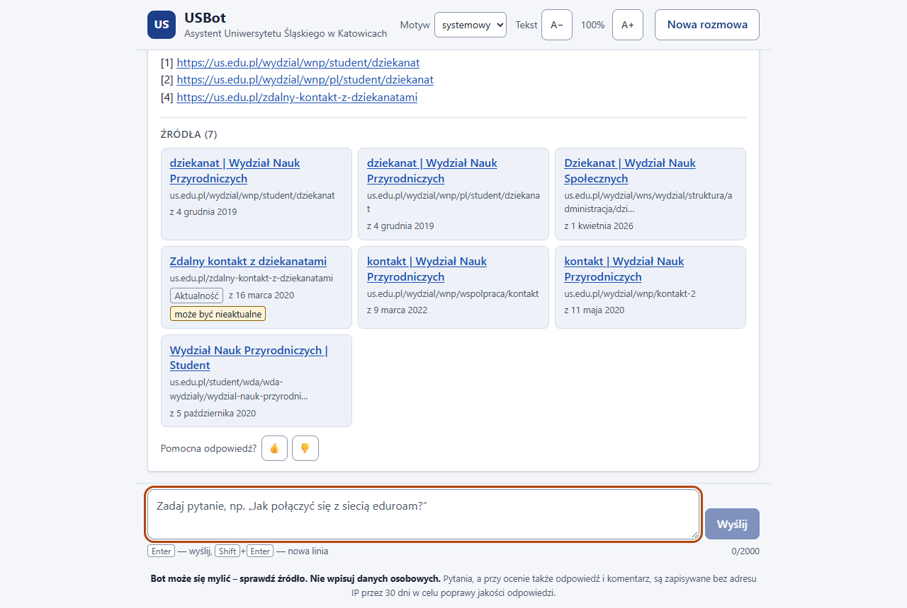

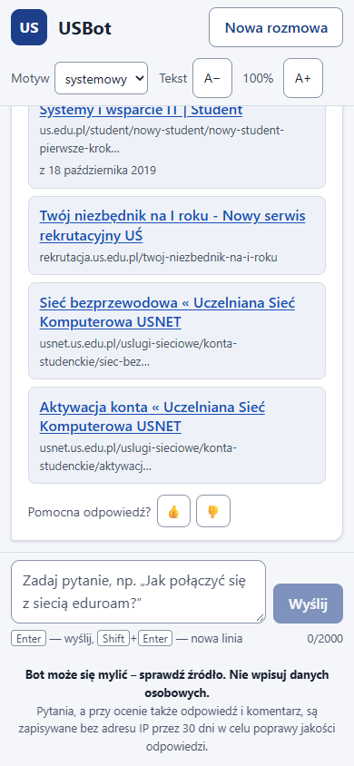

### Druga iteracja: „nowocześniej, spokojnie” (2026-11-24)

Po pierwszej wersji interfejs był czytelny, ale za surowy (dużo bieli, ramek i podkreśleń).
Druga iteracja zostawia układ, kolory i treści, a zmienia detale:

| Było | Jest | Dlaczego |
|---|---|---|
| Przyciski z ramką, promień 4 px | przyciski drugorzędne wypełnione szarym, bez ramki; promień 8 px | lżej, mniej linii na ekranie |
| Pole pytania jako płaski pasek z linią nad nim | karta z cieniem i promieniem 14 px, przycisk ze strzałką w środku; fokus obejmuje całą kartę; tekst rozmowy wygasa nad nią | pole wygląda na miejsce do pisania, a rozmowa nie urywa się na krawędzi |
| Pytanie w szarym prostokącie | pytanie jako większy, ciaśniejszy nagłówek (1,375rem, 650) | hierarchię robi typografia |
| Źródła jako lista z liniami, podkreślone tytuły | cały wiersz klikalny z tłem pod kursorem, numer w małym bordowym kwadracie, tytuł bez podkreślenia | spokojniejsza lista, większy cel kliknięcia |
| Przykładowe pytania jako podkreślone linki | wiersze z szarym tłem pod nagłówkami grup | wyraźnie widać, że można je kliknąć |
| „Kopiuj odpowiedź” jako link | przycisk z ikoną kopiowania, tło dopiero pod kursorem | jedyna ikona przy akcji pod odpowiedzią |
| Sam napis „USBot” | mały bordowy znak (ten sam co favicon) przy nazwie | rozpoznawalna karta przeglądarki i nagłówek, bez znaków UŚ |

Cień mają tylko pole pytania i panel ustawień, czyli elementy leżące nad rozmową. Przejścia
kolorów (120 ms) są wyłączane przy `prefers-reduced-motion`. Rozmiar po zmianie: JS + CSS
79,6 KB + 4,3 KB (gzip), łącznie +4,1 KB od stanu sprzed pierwszej iteracji.
