# 5. Interfejs UI/UX

## 5.1 Opis interfejsu

USBot ma dwa interfejsy na tym samym `ChatService`:

- **Strona WWW** (`web/`, Vite + React + TypeScript) — czat dla studentów. Korzysta z API
  HTTP ([API](api.md), 3.1): wysyła pytanie z historią rozmowy i pokazuje strumień zdarzeń
  SSE — odpowiedź pojawia się na bieżąco, źródła jako karty, pytanie o dziekanat bez
  wydziału kończy się przyciskami wydziałów.
- **Terminal** (`cli.py`) — dla osób technicznych (administratorzy, testy); wypisuje te
  same zdarzenia jako tekst (5.6).

Strona nie używa bibliotek komponentów UI — tylko React. Odpowiedź modelu (Markdown:
nagłówki, listy, pogrubienia, linki) renderuje mały parser w `web/src/markdown.tsx`,
który buduje elementy Reacta bez `innerHTML`, więc tekst z modelu nie może wstrzyknąć
HTML-a, a linki są tylko `http(s)`.

Uruchomienie: [Instrukcja uruchomienia](uruchomienie.md) (krok 7c) albo README.

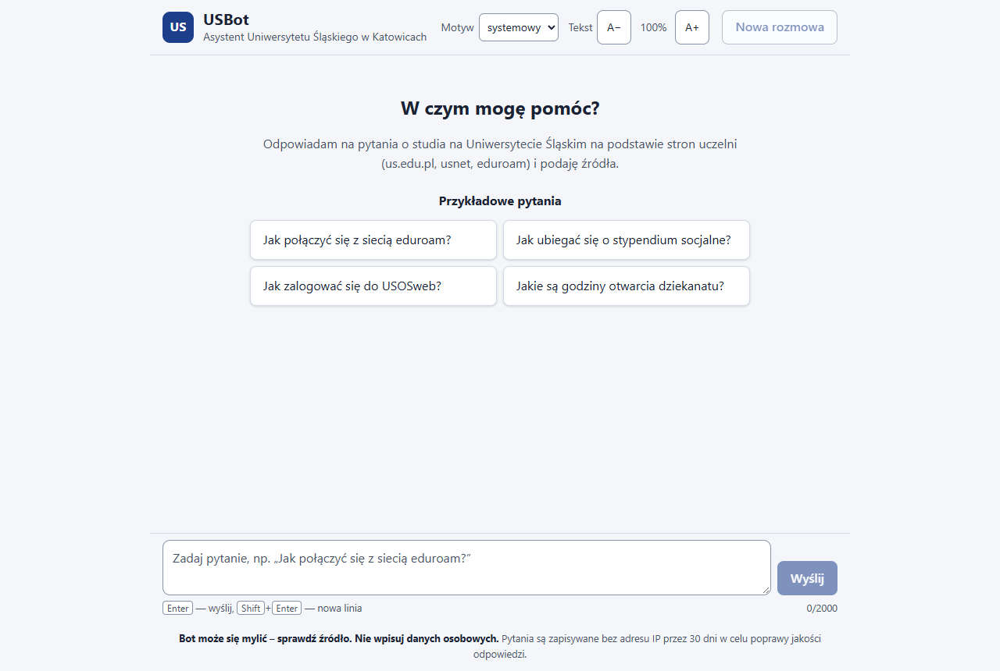

Układ strony od góry:

| Element | Opis |
|---|---|
| Nagłówek | nazwa, ustawienia **Motyw** (systemowy / jasny / ciemny) i **Tekst** (A− / A+, 87,5–150%), przycisk **Nowa rozmowa** |
| Baner stanu | tylko gdy `GET /api/health` przy otwarciu strony zgłasza problem — „Czat może teraz nie działać. Niedostępne: model językowy…” z przyciskiem „Sprawdź ponownie” |
| Rozmowa | ekran powitalny z przykładowymi pytaniami (przyciski) albo lista tur: dymek pytania i dymek odpowiedzi |
| Pole pytania | wieloliniowe, licznik znaków `n/2000`, przycisk **Wyślij** — w trakcie odpowiedzi zamieniony na **Zatrzymaj** |
| Stopka | stały komunikat **„Bot może się mylić – sprawdź źródło. Nie wpisuj danych osobowych.”** i informacja o zapisywaniu pytań bez adresu IP przez 30 dni (RODO — Architektura, 2.4) |

## 5.2 Opis nawigacji

### Strona WWW

| Akcja użytkownika | Zachowanie |
|---|---|
| Wpisanie pytania + `Enter` (albo **Wyślij**) | Pytanie trafia do rozmowy, pole się czyści; odpowiedź generuje się strumieniowo. |
| `Shift`+`Enter` | Nowa linia w pytaniu. |
| `Esc` albo **Zatrzymaj** (w trakcie odpowiedzi) | Przerwanie `fetch` (`AbortController`) — serwer przestaje generować; to, co powstało, zostaje z dopiskiem „Odpowiedź przerwana”. |
| Kliknięcie przykładowego pytania | Wysyła je od razu. |
| Kliknięcie przycisku wydziału (po `clarify`) | Wysyła skrót wydziału, np. „WNP” — serwer rozwija go do pełnej nazwy i łączy z poprzednim pytaniem. |
| **Spróbuj ponownie** (po błędzie) | Wysyła to samo pytanie jeszcze raz, zastępując turę z błędem. |
| **Nowa rozmowa** | Przerywa ewentualną odpowiedź, czyści rozmowę i przenosi fokus do pola pytania. |
| Odświeżenie strony | Rozmowa zostaje (sessionStorage); znika po zamknięciu karty. Odpowiedź przerwana odświeżeniem jest oznaczona jako przerwana. |
| Pierwszy `Tab` na stronie | Link „Przejdź do pola pytania” (skip link). |

Pytanie pustej treści nie jest wysyłane (przycisk wyłączony). Dłuższe niż 2000 znaków —
licznik robi się czerwony („Pytanie jest za długie: 2104 z 2000 znaków”), pole dostaje
`aria-invalid`, wysyłanie jest zablokowane.

### Terminal

| Akcja użytkownika | Zachowanie systemu |
|---|---|
| Wpisanie pytania + Enter | Bot buduje zapytanie z kontekstem, pobiera fragmenty z bazy, generuje odpowiedź (streaming). |
| Pusty Enter | System ignoruje wejście, wyświetla prompt ponownie. |
| `wyjdź` / `exit` / `quit` / `q` | Komunikat „Do widzenia!" i zamknięcie procesu. |
| `Ctrl+C` lub `Ctrl+D` (EOF) | Graceful exit z komunikatem „Do widzenia!". |
| Błąd bazy danych | Komunikat błędu z instrukcją uruchomienia Dockera, pętla kontynuowana. |
| Brak danych w bazie | Bot informuje o braku informacji, sugeruje us.edu.pl lub dziekanat. |
| Pytanie o dziekanat bez wydziału | Bot dopytuje o wydział i wymienia wszystkie (bez wywołania LLM-a); odpowiedź może być skrótem, np. „WNP”. |

## 5.3 Strona WWW — stany i zdarzenia API

Każda tura (pytanie + odpowiedź) ma jeden stan (`TurnStatus` w `web/src/types.ts`).
Zdarzenia z `POST /api/chat` ([API](api.md), 3.1) przełączają go tak:

| Zdarzenie / sytuacja | Stan tury | Widok |
|---|---|---|
| (wysłanie pytania) | `searching` | dymek pytania; w odpowiedzi animowane kropki i „Szukam w serwisach uczelni…”; **Wyślij** → **Zatrzymaj** |
| `sources` | `writing` | „Piszę odpowiedź…” do pierwszego tokenu; karty źródeł pod odpowiedzią |
| `token` | `writing` | tekst dopisywany do dymka (Markdown) z migającym kursorem |
| `done` | `done` | pełna odpowiedź (`answer`) zastępuje sklejone tokeny; pod nią źródła i oceny 👍/👎 |
| `refused` (+ `done`) | `refused` | stały komunikat „Nie mam tej informacji…” z żółtym paskiem i przyciskiem-linkiem **Przejdź do us.edu.pl**; bez źródeł i ocen |
| `clarify` (+ `done`) | `clarify` | pierwsze zdanie komunikatu i siatka przycisków wydziałów (nazwa + skrót) z `options`; gdy `options` przyjdzie puste — lista z `GET /api/faculties`. Przyciski działają tylko w ostatniej turze |
| `error` | `error` | „Nie udało się uzyskać odpowiedzi.” + `message` z serwera (np. „Model językowy jest niedostępny.”) i **Spróbuj ponownie** |
| strumień zamknięty bez `done`/`error` | `error` | „Połączenie zostało przerwane przed końcem odpowiedzi.” |
| **Zatrzymaj** / `Esc` | `stopped` | wygenerowana część + „Odpowiedź przerwana.” (albo „Zatrzymano, zanim powstała odpowiedź.”) |
| HTTP `429` / `503` | `error` | „Za dużo pytań w krótkim czasie. Spróbuj ponownie za N s.” (`503`: „Serwer jest teraz zajęty…”) — N z `Retry-After`; pod polem odliczanie „Kolejne pytanie możesz wysłać za N s.”, **Wyślij** i **Spróbuj ponownie** zablokowane do końca odliczania (pole można dalej edytować) |
| HTTP `422` | `error` | „Pytanie albo historia rozmowy są za długie. Skróć pytanie lub zacznij nową rozmowę.” |
| brak połączenia (`fetch` odrzucony) | `error` | „Brak połączenia z serwerem czatu. Sprawdź połączenie z internetem i spróbuj ponownie.” |

**Źródła** pochodzą wyłącznie ze zdarzenia `sources` (wyniki wyszukiwania), nie z tekstu
odpowiedzi. Karta pokazuje tytuł strony (link, nowa karta), skrócony adres, etykietę
„Aktualność”/„Wydarzenie” dla `page_type` `news`/`event` i datę publikacji
(`published_at`), jeśli jest. Cała karta jest klikalna, ale w drzewie dostępności to jeden
link.

**Historia rozmowy** jest w pamięci karty i w `sessionStorage` (klucz `usbot.conversation`)
— serwer jest bezstanowy. Z każdym pytaniem strona wysyła ostatnie 5 tur
(`API_HISTORY_TURNS`; starszych serwer i tak nie użyje), w limitach API (40 wiadomości,
40 000 znaków — przy przekroczeniu odpada najstarsza tura). Zgodnie z kontraktem do
historii trafia pytanie i `done.answer`; przy `refused`/`clarify` — ich komunikat; po
`error` — samo pytanie; po przerwaniu — pytanie i wygenerowana część (użytkownik ją widzi,
więc model też powinien). Logika: `web/src/history.ts`.

**Oceny 👍/👎** są pod każdą odpowiedzią `done`. 👍 wysyła ocenę od razu. 👎 otwiera
formularz z opcjonalnym komentarzem i przypomnieniem, by nie wpisywać danych osobowych:
fokus trafia do pola, **Esc** albo **Anuluj** zamyka formularz i wraca na przycisk 👎, a
ocena idzie do serwera dopiero po **Wyślij ocenę**. Jedna odpowiedź to jedna ocena. Żądanie
opisuje [API](api.md) (3.1, `POST /api/feedback`). Przy `VITE_FEEDBACK_ENABLED=false`
przyciski są widoczne, ale wyłączone, a odpowiedź `404`/`405` wyłącza oceny do końca wizyty.

### Zrzuty ekranu

Zrzuty z prawdziwym API (Ollama `qwen3:8b`, baza z 2026-11), robione skryptem
`npm run e2e` (`web/scripts/e2e.mjs`, 5.5).

**Strumieniowanie** — tekst dopisywany na bieżąco, kursor, przycisk **Zatrzymaj**:

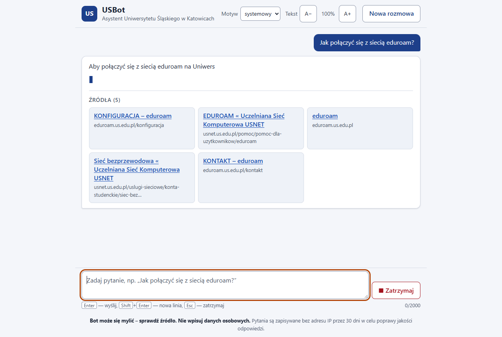

**Odpowiedź ze źródłami i ocenami** (zrzut sprzed włączenia ocen — przyciski są na nim wyłączone):

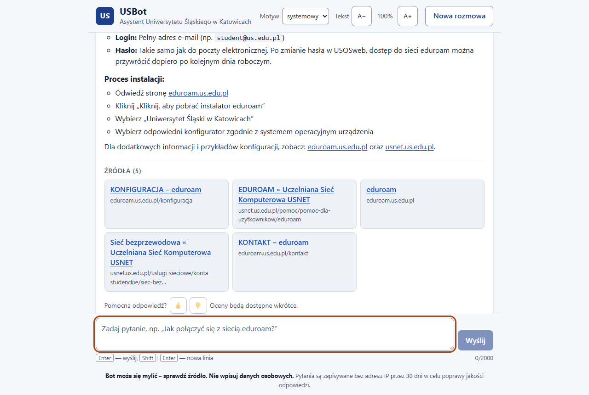

**Dopytanie o wydział** (`clarify`) i odpowiedź po kliknięciu „WNP”:

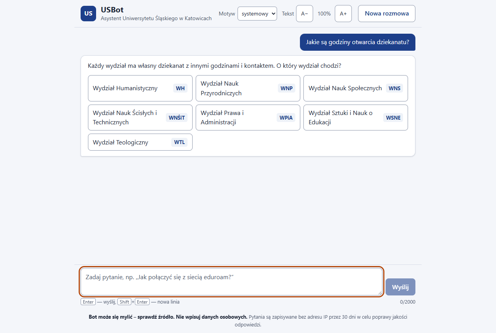

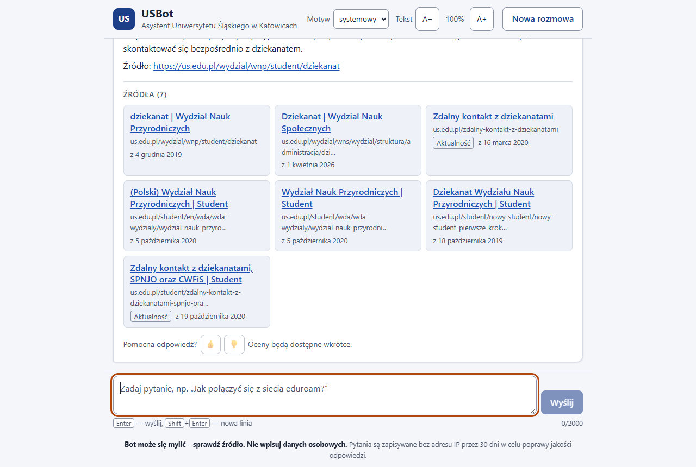

**Brak informacji** (`refused`):

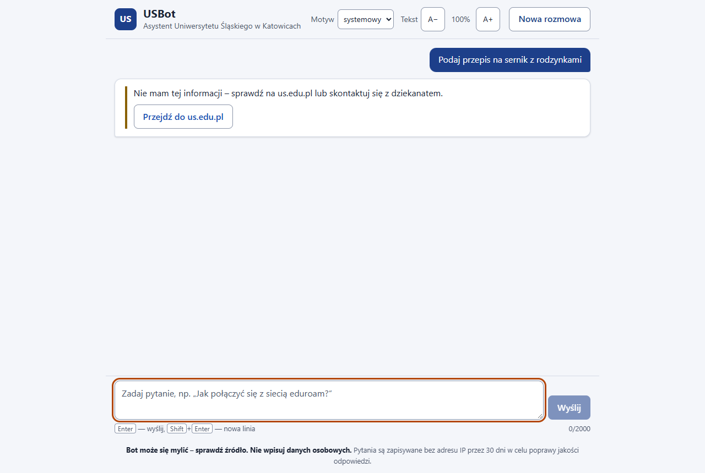

**Przerwana odpowiedź** (`Esc` w trakcie generowania):

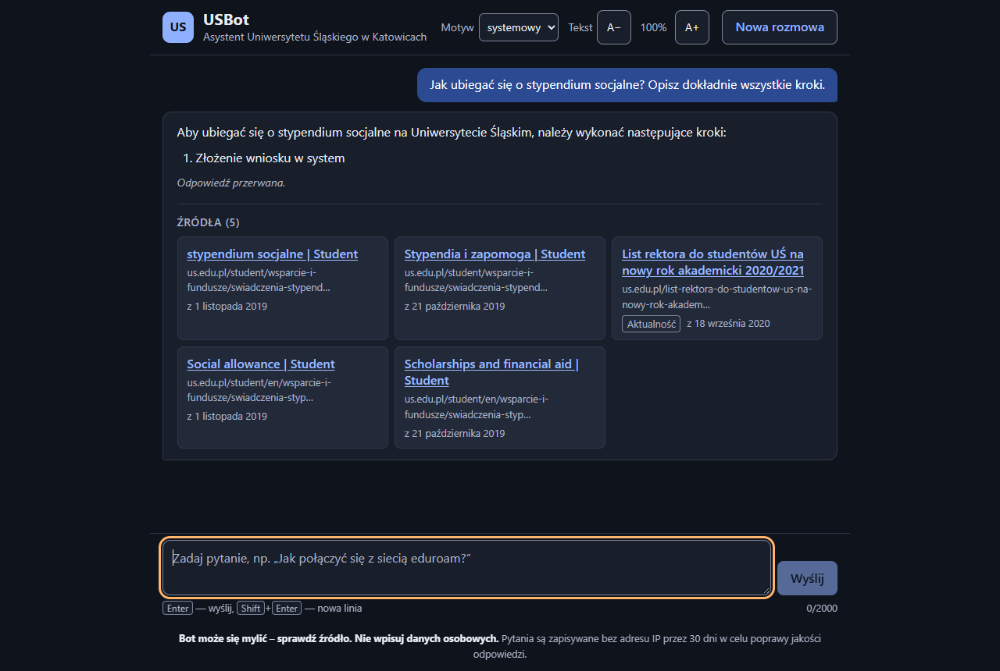

**Limit zapytań** (HTTP `429` z `Retry-After: 42`):

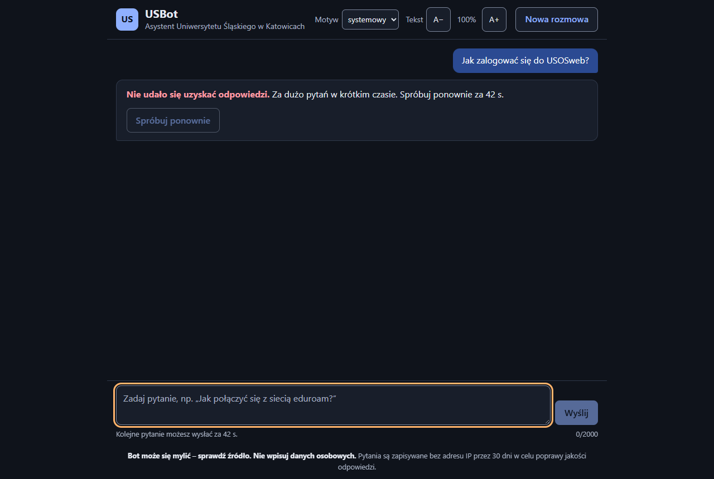

**Tryb ciemny**, **telefon** (390 px) i **tekst 125%**:

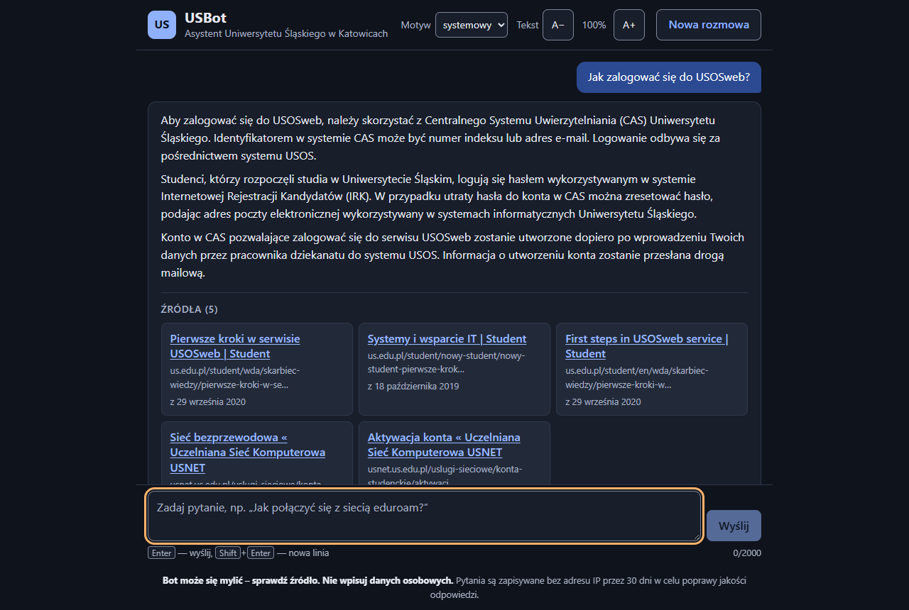

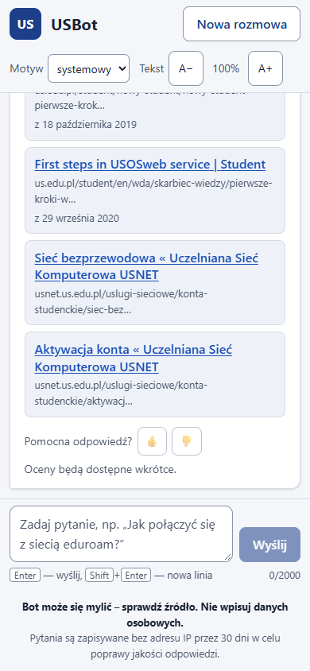

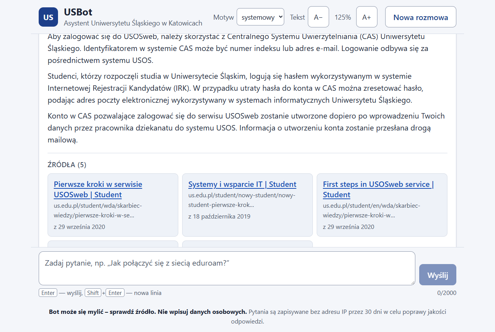

## 5.4 Dostępność (WCAG 2.1 AA)

| Wymaganie | Rozwiązanie |
|---|---|
| Kontrast (1.4.3, 1.4.11) | Kolory jako zmienne CSS w `web/src/styles.css`, sprawdzone dla obu motywów: tekst ≥ 4,5:1 (np. główny niebieski `#1d3f8a` na białym 9,9:1, tekst pomocniczy 7,6:1), obramowania pól i przycisków ≥ 3:1. W trybie wysokiego kontrastu Windows (`forced-colors`) dymki i karty dostają systemowe obramowanie |
| Obsługa klawiaturą (2.1.1, 2.4.3, 2.4.7) | Wszystko to natywne `button`/`a`/`select`/`textarea`; kolejność Tab: skip link → ustawienia → **Nowa rozmowa** → rozmowa (przewijalna klawiszami strzałek) → przyciski w turach → pole pytania. Wyraźna pomarańczowa obwódka fokusu (3 px) odróżnia się od niebieskich elementów. `Enter` / `Shift+Enter` / `Esc` — 5.2. Po kliknięciu wydziału i „Spróbuj ponownie” fokus wraca do pola pytania |
| Strumieniowana odpowiedź (4.1.3) | Ukryty region `aria-live="polite"`, `aria-relevant="additions"`. Czytanie każdego tokenu byłoby nieużywalne, więc tokeny są zbierane i do regionu trafia każde **zakończone zdanie** jako nowy element (czytnik je kolejkuje), bez znaczników Markdownu. Do tego komunikaty stanu: „Szukam odpowiedzi…”, „Znaleziono źródła: 5. Piszę odpowiedź…”, komunikat `refused`/`clarify`, „Zatrzymano generowanie odpowiedzi.”, błędy. Dymek odpowiedzi ma `aria-busy="true"` do końca strumienia. Logika: `web/src/useAnnouncer.ts` |
| Skalowanie tekstu (1.4.4, 1.4.10) | Rozmiary w `rem`; działa zoom przeglądarki do 200% i ustawienie **Tekst** A−/A+ (87,5–150%, zapamiętane w `localStorage`). Układ przechodzi w jedną kolumnę poniżej 640 px bez poziomego przewijania |
| Tryb ciemny | Domyślnie wg systemu (`prefers-color-scheme`), do wyboru w **Motyw**; ustawiany przed pierwszym malowaniem (bez mignięcia jasnego tła) |
| Język (3.1.1) | `<html lang="pl">`, cały interfejs po polsku |
| Etykiety (1.3.1, 3.3.2, 4.1.2) | Pole pytania z etykietą „Twoje pytanie” i opisem (skróty klawiszowe, licznik znaków); grupy przycisków z `aria-label` („Wybierz wydział”, „Oceń odpowiedź”, „Rozmiar tekstu”); 👍/👎 z nazwami „Pomocna”/„Niepomocna” i `aria-pressed`; linki do nowej karty z ukrytym dopiskiem „(otwiera się w nowej karcie)”; błędy z `role="alert"` |
| Ruch (2.3.3) | Przy `prefers-reduced-motion` bez animacji kropek, kursora i płynnego przewijania |
| Cele dotyku (2.5.5, poziom AAA — dodatkowo) | Przyciski min. 44 px wysokości |

## 5.5 Testy interfejsu

- `npm test` (Vitest) — parser SSE (zdarzenia urwane w dowolnym miejscu, `: ping`, CRLF,
  uszkodzony JSON), budowanie historii z tur w każdym stanie i limity, renderer Markdownu
  (brak wstrzyknięcia HTML-a, linki tylko `http(s)`, brak zagnieżdżonych linków, urwane
  `**`).
- `npm run e2e` (`web/scripts/e2e.mjs`) — headless Chrome przez DevTools Protocol, bez
  dodatkowych zależności; wymaga działającego API i `npm run dev`. Scenariusze:
  kolejność Tab i skip link, `Shift+Enter`; strumieniowanie, karty źródeł, `aria-busy`,
  region `aria-live`, sessionStorage po odświeżeniu; `clarify` → klik „WNP” → odpowiedź;
  `refused` z linkiem; `Esc` w trakcie odpowiedzi; `429` (podstawiona odpowiedź) z
  odliczaniem; tryb ciemny, telefon, tekst 125% bez poziomego przewijania; brak błędów w
  konsoli. Zapisuje zrzuty do `docs/img/ui/`. Wynik z 2026-11-06: wszystkie scenariusze OK.

## 5.6 Terminal (CLI) — stany

### Stan: uruchomienie

```text
Ładowanie modelu embeddingów (pierwsze uruchomienie może chwilę potrwać)...
============================================================
   Bot Uniwersytetu Śląskiego w Katowicach
   Wpisz 'wyjdź' lub Ctrl+C aby zakończyć
============================================================
```

### Stan: błąd bazy danych

```text
[Błąd bazy danych: connection refused]
[Upewnij się że Postgres działa i uruchom: docker compose up -d db]
```

### Stan: brak informacji

```text
Bot: Nie mam tej informacji - sprawdź na us.edu.pl lub skontaktuj się z dziekanatem.
```

### Stan: dopytanie o wydział

```text
Ty: Jakie są godziny otwarcia dziekanatu?

Bot: Każdy wydział ma własny dziekanat z innymi godzinami i kontaktem. O który wydział chodzi?
- Wydział Humanistyczny (WH)
- Wydział Nauk Przyrodniczych (WNP)
- Wydział Nauk Społecznych (WNS)
- Wydział Nauk Ścisłych i Technicznych (WNŚiT)
- Wydział Prawa i Administracji (WPiA)
- Wydział Sztuki i Nauk o Edukacji (WSNE)
- Wydział Teologiczny (WTL)

Ty: WNP
```

Po odpowiedzi bot szuka z pełną nazwą wydziału i odpowiada już przez LLM-a.

!!! note "Kodowanie znaków"
    Na Windows aplikacja jawnie ustawia `sys.stdout.reconfigure(encoding="utf-8")`,
    bo domyślne `cp1252` nie obsługuje polskich znaków. Dzięki temu interfejs działa
    poprawnie na każdym systemie.
